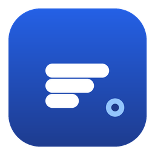
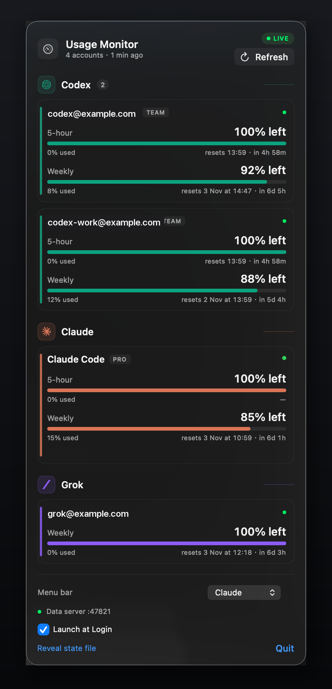
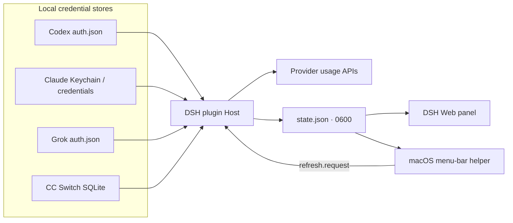

<div align="center">



<h1>DSH Usage Monitor</h1>

<p><b>Every Codex, Claude and Grok quota. One glance.</b></p>

<p>
A DeepSeek Harness bundle and a native macOS menu-bar companion that show the
remaining quota, reset countdown and refill reminders for <b>every local
account</b> — without opening another dashboard.
</p>

<p>
<a href="https://github.com/cheungringo420/dsh-usage-monitor/releases/latest">

</a>
</p>

<p>
<a href="https://github.com/cheungringo420/dsh-usage-monitor/actions/workflows/checks.yml">

</a>
<a href="LICENSE"></a>


<a href="https://github.com/cheungringo420/dsh-usage-monitor/releases/latest"></a>
</p>

</div>

> **What it is:** the plugin lives inside DeepSeek Harness and reads the same
> official usage APIs the CLIs use. The menu-bar app is a read-only companion
> that consumes the plugin's local snapshot. Neither calls a model endpoint, so
> checking quota does not consume inference tokens.

---

## Why you’ll want it

| | |
|---|---|
| **Stop guessing which account has headroom** | Two Codex logins in the same ChatGPT team can share a team id but not their quota. The plugin identifies each by JWT user, so every account gets its own card and its own numbers. |
| **Don’t get cut off mid-task** | 5-hour and weekly windows, Opus/Sonnet/extra usage and Grok product breakdowns, each with a live reset countdown. Reset and refill events can toast in-app or notify through macOS. |
| **One panel instead of three tabs** | Codex, Claude and Grok side by side, with real provider marks and colors, from the sidebar, the composer strip or the menu bar. |
| **Let your agent pick the account** | The `usage_status` tool lets the agent answer “which account should this long run use?” instead of guessing. |
| **Keep credentials local** | Credentials are read on-device and never sent to this project or to the browser. Tokens never enter the snapshot. |

### Use cases

- **Parallel agent work.** Run Codex and Claude agents at the same time and see
  which 5-hour window is closest to a reset before you start.
- **Multi-account teams.** Two ChatGPT users share a team `account_id` but have
  separate usage; both appear, including the CC Switch copies.
- **Quota-aware scheduling.** Kick off the long build when the weekly window has
  the most headroom, not when it expires.
- **Cross-provider fallback.** If Claude is at 3% but Codex weekly is open, move
  the next task to Codex.
- **Glanceable menu bar.** Keep the tightest number in the menu bar (or pin it to
  one provider) and open the popover only when you need the whole picture.
- **Automation.** A `usage_status` tool plus a state file the menu-bar app and
  other local tools can read.

---

## Screenshots

<div align="center">

</div>

<p align="center"><sub>Illustrative menu-bar popover. Account labels are examples; provider marks are trademarks of their owners (see <a href="NOTICE">NOTICE</a>).</sub></p>

What you are looking at:

1. **LIVE pill** — a fresh snapshot; the text underneath tells you how old it is.
2. **Refresh** — asks the DSH plugin to fetch every provider immediately (not just
   re-read the local file).
3. **Provider sections** — real brand marks and colours, one section per
   provider, only shown when an account exists.
4. **Account cards** — per-account bars, used/remaining percentages, absolute
   reset time and relative countdown.
5. **Menu bar picker** — *Worst of all*, Codex, Claude or Grok. The menu-bar
   number and icon follow the selection.
6. **Footer** — data-server health, Launch at Login, Reveal state file, Quit.

---

## Features

| Feature | Codex | Claude | Grok |
|---|:---:|:---:|:---:|
| 5-hour + weekly windows | ✅ | ✅ | weekly |
| Opus / Sonnet / extra usage | — | ✅ | — |
| Product breakdown | credits | — | ✅ |
| Multiple local accounts | ✅ | ✅ | ✅ |
| Reset / refill reminders | ✅ | ✅ | ✅ |
| Menu-bar provider picker | ✅ | ✅ | ✅ |
| Agent `usage_status` tool | ✅ | ✅ | ✅ |
| Credential auto-refresh | — | ✅ Keychain | — |

- **In-app panel** in the DSH sidebar, plus a compact strip under the composer.
- **Native macOS menu bar** with the provider mark, the selected number and a
  popover.
- **Multiple accounts per provider**, including several Codex users on one team.
- **Reset/refill detection** with in-app toasts and optional native
  notifications.
- **Local-first**: only provider metadata endpoints are called; no telemetry, no
  accounts or tokens sent to a third-party service.
- **Claude Code OAuth refresh** from the macOS Keychain, with write-back, so a
  daily re-login is not needed.
- **Agent-friendly**: `usage_status` returns JSON or a compact text report.
- **Menu-bar icons** rendered from the actual OpenAI, Claude and Grok marks, in
  each provider's colour.

---

## How it works



The plugin is the only component that talks to providers. It discovers local
accounts, adapts each provider's response into a common window model, stores a
non-secret snapshot, and exposes it over the existing authenticated `/api`
bridge. The browser and the menu-bar helper only see labels, percentages and
reset times.

The menu-bar helper cannot access the browser-authenticated `/api` bridge, so it
reads the state file directly. Its **Refresh** button writes a tiny
`refresh.request` file next to the snapshot; the plugin watches it and performs a
real provider fetch. DeepSeek Harness must be running for that to work.

Read more in **[docs/ARCHITECTURE.md](docs/ARCHITECTURE.md)**.

---

## Quick start

### Requirements

| | |
|---|---|
| **DeepSeek Harness** | The plugin host. Install the desktop app or run DSH however you normally do. |
| **Codex** | Codex CLI signed in with your ChatGPT account: `codex login` |
| **Claude** | Claude Code CLI signed in with the subscription account: `claude` → `/login` |
| **Grok** | Grok CLI signed in: `grok login` |
| **Optional** | CC Switch if you keep multiple Codex accounts there |
| **Menu-bar app** | macOS 14+; prebuilt download, or Xcode 15+ and XcodeGen to build |

You do **not** need all three providers. Missing providers are simply absent.

### 1. Get the code

```bash
git clone https://github.com/cheungringo420/dsh-usage-monitor.git
cd dsh-usage-monitor
```

Prefer a ZIP? Use **Code → Download ZIP**, or download the latest **Release**.

### 2. Install the DSH plugin

The bundle is a local package; it is not published to npm. The supported path is
DeepSeek Harness's **Plugin Manager**:

1. Open DeepSeek Harness.
2. In a session, ask the agent to install the local bundle at
   `<absolute-path>/plugin`.
3. Wait for the `usage-monitor` bundle to become active, then refresh the Web
   page once.

<details>
<summary><b>Advanced: install the profile manually</b></summary>

Add a link dependency to `$DSH_HOME/profiles/<profile>/package.json`:

```json
"dependencies": {
  "@local/usage-monitor": "link:/absolute/path/to/dsh-usage-monitor/plugin"
}
```

Add `"@local/usage-monitor"` to the same file's `dsh.profile.bundles`, run
`pnpm install` in the profile directory, and restart DeepSeek Harness. The
bundle's `plugin/cordis.patch.yml` inserts the row and default config.

</details>

### 3. Sign in to the provider CLIs

```bash
codex login                     # ChatGPT / Codex
claude                          # then /login inside Claude Code
grok login                      # Grok
```

Claude rules:

- Use the **same subscription account** as Claude Desktop for matching numbers.
- Use `/login`, **not** `claude setup-token`. The setup token is inference-only
  and lacks the `user:profile` scope needed by the usage endpoint.
- A third-party relay/API-key provider has no subscription usage endpoint.

### 4. Install the menu-bar app

**Option A — download the prebuilt helper** from
[Releases](https://github.com/cheungringo420/dsh-usage-monitor/releases/latest),
then:

```bash
unzip ~/Downloads/UsageWidget-1.0.0.zip -d /tmp
ditto /tmp/UsageWidget.app /Applications/UsageWidget.app
xattr -cr /Applications/UsageWidget.app
open /Applications/UsageWidget.app
```

The downloaded app is ad-hoc signed, not notarized. macOS may block the first
launch; right-click → **Open**, or use the `xattr` command above.

**Option B — build from source:**

```bash
brew install xcodegen
cd menu-bar
xcodegen generate

xcodebuild -project UsageWidget.xcodeproj \
  -scheme UsageWidgetHost -configuration Release \
  -derivedDataPath /tmp/UsageWidgetDerived build

ditto /tmp/UsageWidgetDerived/Build/Products/Release/UsageWidget.app \
  /Applications/UsageWidget.app
xattr -cr /Applications/UsageWidget.app
open /Applications/UsageWidget.app
```

Change `options.bundleIdPrefix` and the two `PRODUCT_BUNDLE_IDENTIFIER`s in
`menu-bar/project.yml` to your own prefix before shipping your own build.

### 5. Open it

- **In DSH:** sidebar gauge → Usage Monitor, or the strip under the composer.
- **Menu bar:** the provider mark + number; click for the full popover.
- Use the **Menu bar** picker to choose *Worst of all*, Codex, Claude or Grok.
- Turn on **Launch at Login** in the popover.

If the panel is empty, use the troubleshooting table below.

---

## How to use

### The in-app panel

Click the gauge in the sidebar (or the strip under the composer). Every account
is grouped under its provider. A card shows:

- **5-hour / weekly** bars, used and remaining percentages;
- the absolute reset time in your local timezone;
- a live countdown (`in 4h 58m`, `in 6d 5h`);
- Opus/Sonnet/extra usage for Claude, product breakdown for Grok;
- an account status dot and a sanitized error if a provider failed.

### The menu-bar app

The label shows the **tightest remaining window** for the current selection.
*Worst of all* follows whichever provider is driving the number; choosing a
provider pins both the icon and the number to that provider.

- Click the label for the full popover.
- **Refresh** asks the plugin to fetch every provider immediately. It requires
  DSH to be running, and shows a spinner while waiting.
- **Reveal state file** opens the snapshot in Finder.
- **Quit** exits the helper; reopening it restores the last state.

### Reminders

The plugin compares snapshots and detects:

- **reset** — a window's reset time moved forward and used percent dropped;
- **refill** — used percent dropped without a reset;
- **low** — remaining percent crossed the configured threshold.

In-app toasts are on by default. Native macOS notifications are opt-in through
`notifications.macos`.

### Ask the agent

The plugin registers a `usage_status` tool. Try:

> Which Codex account has the most weekly headroom?
>
> Are any accounts below 10%?
>
> What is my Claude 5-hour reset time?

The tool reads the same snapshot as the UI.

---

## Configuration

Override the defaults in `$DSH_HOME/profiles/<profile>/cordis.patch.yml`
(usually `~/.dsh/profiles/<profile>/cordis.patch.yml`):

```yaml
- id: usage-monitor
  name: '@local/usage-monitor'
  config:
    pollSeconds: 300          # provider fetch cadence, 60–3600
    refreshMinSeconds: 120    # per-account floor, 30–3600
    claudeRefreshTokens: true # auto-refresh Claude Code OAuth from Keychain
    notifications:
      toast: true             # in-app reset/refill toasts
      macos: false            # native macOS notifications
      lowThreshold: 10        # warn at/below this % remaining
    discovery:
      cli: true               # Codex/Claude/Grok CLI stores
      ccSwitch: true          # CC Switch DB, read-only
    ui:
      dock: true              # compact strip under the composer
    accounts: []              # optional manual accounts
```

| Key | Default | Notes |
|---|---|---|
| `pollSeconds` | `300` | Background provider refresh cadence. |
| `refreshMinSeconds` | `120` | Minimum gap per account; manual refresh bypasses it. |
| `claudeRefreshTokens` | `true` | Refresh Claude Code OAuth from the Keychain and write back. |
| `notifications.toast` | `true` | In-app reset/refill toasts. |
| `notifications.macos` | `false` | Native notifications via `osascript`. |
| `notifications.lowThreshold` | `10` | Low-quota warning threshold. |
| `discovery.cli` | `true` | Read Codex/Claude/Grok CLI credential stores. |
| `discovery.ccSwitch` | `true` | Read the CC Switch SQLite DB, read-only. |
| `ui.dock` | `true` | Composer strip. |
| `accounts` | `[]` | Manual accounts with `tokenEnv` or `tokenFile`. |

<details>
<summary><b>Manual accounts and multiple Codex logins</b></summary>

```yaml
    accounts:
      - id: codex-work
        provider: codex
        label: Codex · work
        tokenFile: ~/.secrets/codex-work.json
      - id: claude-team
        provider: claude
        label: Claude · team
        tokenEnv: CLAUDE_TEAM_TOKEN
```

A token file may be a raw token or any CLI JSON shape (`.key`,
`.tokens.access_token`, `.claudeAiOauth.accessToken`). Codex manual accounts can
add `accountId` and `plan`.

Additional Codex CLI homes are discovered automatically. Run:

```bash
CODEX_HOME=~/.codex-work codex login
```

and `~/.codex-work/auth.json` becomes another account.

</details>

---

## Data sources

| Provider | Credential (read locally) | Usage endpoint |
|---|---|---|
| Codex | `~/.codex/auth.json`, `~/.codex-*/auth.json`, CC Switch rows | `GET https://chatgpt.com/backend-api/wham/usage` |
| Claude | macOS Keychain `Claude Code-credentials`, `~/.claude/.credentials.json`, `CLAUDE_CODE_OAUTH_TOKEN` | `GET https://api.anthropic.com/api/oauth/usage` |
| Grok | `~/.grok/auth.json` | `GET https://cli-chat-proxy.grok.com/v1/billing?format=credits` |
| Manual | `tokenEnv` / `tokenFile` | the provider's endpoint |

These are the same usage/billing metadata endpoints the official CLIs use. They
are undocumented and may change; a provider failure is isolated to that
provider's card.

### Refresh rates

| Layer | Cadence |
|---|---|
| Provider usage calls | every **5 min** per account |
| Per-account floor (background) | **2 min**; manual Refresh bypasses it |
| DSH scheduler check | every 30 s; fetches when the snapshot is 5 min old |
| In-app panel poll | every 60 s; triggers a host refresh when stale |
| Menu-bar state read | every 10 s; countdown text every 30 s |
| Menu-bar **Refresh** | immediate provider fetch via `refresh.request` |
| STALE marker | 15 min without a new snapshot |

Metadata requests consume network/rate-limit budget, not inference tokens or
subscription quota. Grok's billing endpoint has an observed ~5-minute cooldown,
so lowering the cadence much further has diminishing returns.

---

## Claude token refresh

Claude Code access tokens last about eight hours. With
`claudeRefreshTokens: true` (the default), the plugin:

1. reads the Keychain when the token is within two minutes of expiry, or after a
   401;
2. exchanges the refresh token at
   `https://platform.claude.com/v1/oauth/token` with the Claude Code client id;
3. writes the new access token and rotated refresh token back to the same
   `Claude Code-credentials` item, preserving `mcpOAuth`;
4. retries the usage request.

The refresh token lasts roughly 27 days. After it expires, or after a
logout/password change, sign in once more:

```bash
claude
/login
```

Set `claudeRefreshTokens: false` for strictly read-only behaviour. The plugin
never writes tokens to its state file, HTTP routes, logs, the helper or the
browser.

Claude automatic refresh is macOS-only because it uses the Keychain. On other
platforms the plugin reads the Claude credential but does not renew it.

---

## Privacy and security

- Credentials are read into process memory only. Tokens never enter
  `state.json`, HTTP responses, the menu-bar app, or logs.
- `$DSH_HOME/usage-monitor/state.json` is mode **0600** and contains account
  labels, emails, percentages, reset times and sanitized errors. The menu-bar
  helper needs to read it.
- Claude refresh writes **only** the Keychain item Claude Code already owns.
  Disable it with `claudeRefreshTokens: false`.
- CC Switch is opened with `sqlite3 -readonly` and never written.
- The menu-bar helper serves a **loopback-only** endpoint on
  `127.0.0.1:47821` with a static local token, and accepts refresh requests via
  `usage-monitor/refresh.request` next to the state file. Both are local,
  same-user mechanisms.
- The monitor calls usage/billing metadata endpoints only. It never sends prompts
  or consumes model tokens.
- No telemetry, no analytics, no third-party server.

Security issues: see [SECURITY.md](SECURITY.md). Please do not paste tokens into
an issue.

---

## Troubleshooting

<details>
<summary><b>No sidebar icon or panel</b></summary>

Confirm the `usage-monitor` bundle is installed and active in Plugin Manager,
then refresh the Web page. Package name: `@local/usage-monitor`.
</details>

<details>
<summary><b>No accounts</b></summary>

Sign in with `codex login`, `claude` → `/login`, and `grok login`. Check
`~/.codex/auth.json`, the Claude Keychain item, and `~/.grok/auth.json`. The empty
state also lists the commands.
</details>

<details>
<summary><b>Claude says “not signed in”</b></summary>

Only an official Claude Code OAuth login exposes quota. A relay
`ANTHROPIC_AUTH_TOKEN` or `claude setup-token` will not work.
</details>

<details>
<summary><b>Claude HTTP 401</b></summary>

Auto-refresh could not renew the credential (refresh token expired/revoked or
Keychain write failed). Run `claude` → `/login` again.
</details>

<details>
<summary><b>Menu bar says STALE</b></summary>

DeepSeek Harness is closed or the plugin has not written a snapshot for 15
minutes. Start DSH, then press **Refresh**.
</details>

<details>
<summary><b>Refresh changes nothing</b></summary>

DSH must be running: the helper writes `refresh.request`; the plugin watches it
every two seconds. The in-app Refresh uses the authenticated
`/api/usage-monitor/refresh` route instead. If DSH is closed the spinner stops
without a change.
</details>

<details>
<summary><b>Menu-bar build fails with “resource fork / detritus”</b></summary>

Build under `/tmp` (or another non-file-provider path) and clear xattrs:
`xattr -cr /Applications/UsageWidget.app`.
</details>

<details>
<summary><b>Widget missing from Edit Widgets</b></summary>

Expected for ad-hoc builds. `chronod` ignores widget extensions from
ad-hoc-signed apps. Sign with an Apple Development/Developer ID identity and
reinstall; the menu-bar surface works without it.
</details>

<details>
<summary><b>Port 47821 is busy</b></summary>

Quit other copies of the helper before launching a new one.
</details>

<details>
<summary><b>Only one Codex account appears</b></summary>

The second login must be a different JWT user. Use another ChatGPT account, a
separate `CODEX_HOME`, or a manual `tokenFile` entry.
</details>

---

## FAQ

<details>
<summary><b>Do I need the menu-bar app?</b></summary>

No. The DSH panel and the `usage_status` tool work on their own. The helper is a
macOS convenience.
</details>

<details>
<summary><b>Does it work on Windows or Linux?</b></summary>

The plugin runs wherever DeepSeek Harness runs. The menu-bar app is macOS 14+
only. Claude auto-refresh is macOS-only.
</details>

<details>
<summary><b>Does checking quota consume my usage?</b></summary>

No. The plugin calls usage/billing metadata endpoints, not model inference
endpoints. It does use network requests and the provider's request rate budget.
</details>

<details>
<summary><b>Will this get my account banned?</b></summary>

It uses the same usage endpoints as the official CLIs and only reads metadata.
There is no guarantee; provider APIs are undocumented and terms can change. Use
at your own discretion and respect each provider's terms.
</details>

<details>
<summary><b>Why does Claude Desktop look different?</b></summary>

Claude Desktop shares the same quota pool but stores its own session. The plugin
reads the **Claude Code** credential. Sign in to Claude Code with the same
account if you want matching numbers.
</details>

<details>
<summary><b>Does the menu-bar helper upload anything?</b></summary>

No. It reads the local state file and talks only to the local DSH plugin through
the state file and `refresh.request`.
</details>

---

## Repository layout

```
.
├── plugin/                 DeepSeek Harness bundle
│   ├── index.js            Host half: discovery, adapters, routes, tool
│   ├── client.js           Browser half: panel, dock strip, toasts
│   ├── lib/                Accounts, providers, state, utils
│   ├── locale/             Plugin Manager metadata (en, zh)
│   ├── cordis.patch.yml    Bundle default config
│   └── package.json
├── menu-bar/               Native macOS menu-bar app
│   ├── Host/               MenuBarExtra app, loopback state server, Refresh
│   ├── Shared/             Snapshot models and formatting
│   ├── Widget/             Experimental WidgetKit extension
│   ├── project.yml         XcodeGen project definition
│   └── README.md
├── docs/
│   ├── ARCHITECTURE.md
│   └── images/             README assets
├── .github/                Checks, issue templates
├── LICENSE
└── NOTICE
```

Detailed docs:

- [Plugin README](plugin/README.md)
- [Menu-bar README](menu-bar/README.md)
- [Architecture](docs/ARCHITECTURE.md)

---

## Roadmap

- [x] Codex, Claude and Grok adapters
- [x] Multiple accounts and JWT-based Codex identity
- [x] Native menu-bar app with provider picker
- [x] Reset/refill reminders
- [x] Claude Code OAuth auto-refresh
- [x] Prebuilt menu-bar download
- [ ] Notarized helper release
- [ ] WidgetKit extension after signing
- [ ] More providers / custom adapters
- [ ] Linux tray companion

---

## Contributing

Issues and pull requests are welcome. Please read [CONTRIBUTING.md](CONTRIBUTING.md)
before opening a PR, and use the issue templates for bugs/features. Never commit
credentials, tokens, snapshots or personal account data.

- [Bug report](.github/ISSUE_TEMPLATE/bug_report.yml)
- [Feature request](.github/ISSUE_TEMPLATE/feature_request.yml)
- [Security policy](SECURITY.md)
- [Changelog](CHANGELOG.md)

---

## License and trademarks

Code is MIT licensed; see [LICENSE](LICENSE).

The bundled OpenAI knot, Claude starburst and Grok slash are trademarks of their
respective owners, used only to identify the services in a local dashboard. They
are **not** covered by the MIT license; see [NOTICE](NOTICE). Replace or remove
them before redistributing the application commercially.

OpenAI, ChatGPT, Codex, Claude, Anthropic, Grok and xAI are trademarks of their
respective owners. This project is not affiliated with or endorsed by them.
Provider usage endpoints are undocumented and may change without notice.

<div align="center">
<sub>Built for people who run more than one model account at a time.</sub>
</div>
