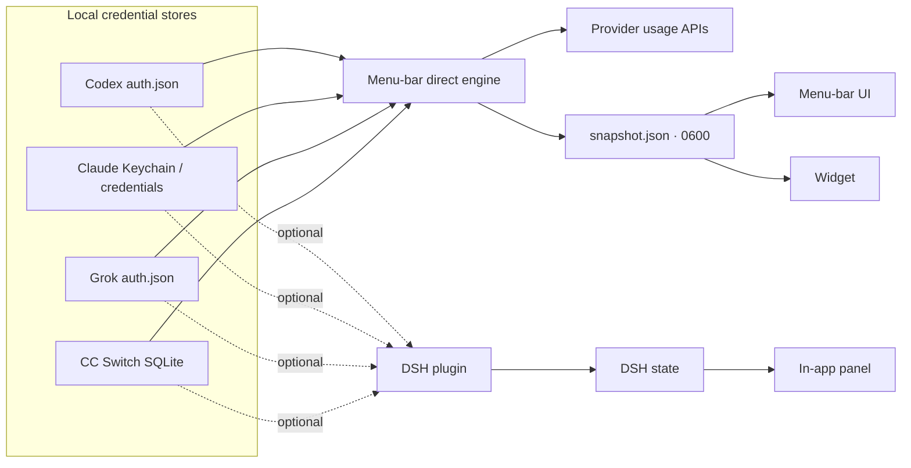

<div align="center">


<h1>Usage Monitor</h1>

<p><b>Every Codex, Claude and Grok quota. One glance. No server required.</b></p>

<p>
A native macOS menu-bar app for every local Codex, Claude and Grok account.
It reads the same credential stores as the CLIs and calls the providers' usage
APIs directly — <b>DeepSeek Harness is optional</b>.
</p>

<p>
<a href="https://github.com/cheungringo420/dsh-usage-monitor/releases/latest">

</a>
</p>

<p>
<a href="https://github.com/cheungringo420/dsh-usage-monitor/actions/workflows/checks.yml">

</a>
<a href="LICENSE"></a>


<a href="https://github.com/cheungringo420/dsh-usage-monitor/releases/latest"></a>
</p>

</div>

> **How it works:** the menu-bar app is self-contained. It discovers local
> logins, calls only usage/billing metadata endpoints, and writes its own
> non-secret snapshot. No model endpoint is called, so checking quota does not
> consume inference tokens. The optional DeepSeek Harness bundle adds an in-app
> panel, composer strip, notifications and a `usage_status` agent tool.

---

## Why you’ll want it

| | |
|---|---|
| **It just works on a new Mac** | Install the app, sign in with the CLIs you already use, and the number appears. No DeepSeek Harness install, no server, no state file to seed. |
| **Stop guessing which account has headroom** | Two Codex logins in the same ChatGPT team can share a team id but not their quota. Each account is identified by JWT user, so every login gets its own card. |
| **Don’t get cut off mid-task** | 5-hour and weekly windows, Opus/Sonnet/extra usage and Grok product breakdowns, each with a live reset countdown. |
| **One glance instead of three tabs** | Codex, Claude and Grok in a single menu-bar popover, with real provider marks and colours. |
| **Credential refresh built in** | Claude Code OAuth is refreshed from the macOS Keychain and written back, so the number does not go stale every eight hours. |
| **Local-only** | Credentials stay on the device. The snapshot contains labels, percentages and reset times — never tokens. |

### Use cases

- **New machine / clean setup.** You only want the menu-bar number; skip the
  harness entirely.
- **Parallel agent work.** Run Codex and Claude agents at once and see which
  5-hour window is closest to a reset.
- **Multi-account teams.** Two ChatGPT users share a team `account_id` but have
  separate usage; both appear, including CC Switch copies.
- **Quota-aware scheduling.** Start the long build when the weekly window has
  the most headroom.
- **Cross-provider fallback.** If Claude is low but Codex weekly is open, move
  the next task to Codex.
- **Pinned menu bar.** Show the worst of all providers, or pin it to one.
- **Optional in-app panel.** If you use DeepSeek Harness, add the bundle for the
  sidebar panel, toasts and the `usage_status` tool.

---

## Screenshots

<div align="center">

</div>

<p align="center"><sub>Illustrative menu-bar popover. Account labels are examples; provider marks are trademarks of their owners (see <a href="NOTICE">NOTICE</a>).</sub></p>

What you are looking at:

1. **LIVE pill** — a fresh snapshot; the text underneath tells you how old it is.
2. **Refresh** — reads local credentials and fetches every provider immediately.
3. **Provider sections** — real brand marks and colours, one section per
   provider, only shown when an account exists.
4. **Account cards** — per-account bars, used/remaining percentages, absolute
   reset time and relative countdown.
5. **Menu bar picker** — *Worst of all*, Codex, Claude or Grok. The menu-bar
   number and icon follow the selection.
6. **Footer** — data-server health, Launch at Login, Reveal state file, Quit.

---

## Features

| Feature | Codex | Claude | Grok |
|---|:---:|:---:|:---:|
| 5-hour + weekly windows | ✅ | ✅ | weekly |
| Opus / Sonnet / extra usage | — | ✅ | — |
| Product breakdown | credits | — | ✅ |
| Multiple local accounts | ✅ | ✅ | ✅ |
| Reset countdowns | ✅ | ✅ | ✅ |
| Menu-bar provider picker | ✅ | ✅ | ✅ |
| Standalone (no DSH) | ✅ | ✅ | ✅ |
| Credential auto-refresh | — | ✅ Keychain | — |

- **Standalone direct engine** — reads `~/.codex`, the macOS Keychain,
  `~/.claude`, `~/.grok` and CC Switch; no harness needed.
- **Native macOS menu bar** with provider mark, selected number and popover.
- **Multiple accounts per provider**, including several Codex users on one team.
- **Actual provider marks** (OpenAI knot, Claude starburst, Grok slash) in each
  provider's colour.
- **Claude Code OAuth refresh** with write-back, so a daily re-login is not
  needed.
- **Optional DSH bundle** with sidebar panel, composer strip, reset/refill
  toasts, native notifications and the `usage_status` tool.
- **Local-first**: only provider metadata endpoints; no telemetry; no tokens in
  the snapshot.

---

## How it works



The menu-bar app performs discovery, provider requests and normalization itself.
It writes its own snapshot; the widget server reads the same file. DeepSeek
Harness is **not** involved in this path.

If you also install the DSH bundle, the plugin independently discovers the same
accounts and powers the in-app panel and agent tool. The two paths do not depend
on each other.

Read more in **[docs/ARCHITECTURE.md](docs/ARCHITECTURE.md)**.

---

## Quick start

### Requirements

| | |
|---|---|
| **macOS** | 14 Sonoma or newer for the menu-bar app |
| **At least one login** | `codex login`, `claude` → `/login`, and/or `grok login` |
| **DeepSeek Harness** | **Optional** — only for the in-app panel and agent tool |
| **Xcode 15+ / XcodeGen** | Only needed when building from source |

You do **not** need all three providers. Missing providers are simply absent.

### 1. Get the app

Download the latest **`UsageWidget-1.1.0.zip`** from
[Releases](https://github.com/cheungringo420/dsh-usage-monitor/releases/latest),
or clone this repository if you want to build it yourself.

### 2. Sign in to the provider CLIs

The app never asks for credentials in its own UI; it reads the credentials your
CLIs already store.

```bash
codex login                     # ChatGPT / Codex
claude                          # then /login inside Claude Code
grok login                      # Grok
```

Claude rules:

- Use the **same subscription account** as Claude Desktop for matching numbers.
- Use `/login`, **not** `claude setup-token`. The setup token is inference-only
  and lacks the `user:profile` scope needed by the usage endpoint.
- A third-party relay/API-key provider has no subscription usage endpoint.

### 3. Install the menu-bar app

**Option A — prebuilt (recommended):**

```bash
unzip ~/Downloads/UsageWidget-1.1.0.zip -d /tmp
ditto /tmp/UsageWidget.app /Applications/UsageWidget.app
xattr -cr /Applications/UsageWidget.app
open /Applications/UsageWidget.app
```

The downloaded app is ad-hoc signed, not notarized. macOS may block the first
launch; right-click → **Open**, or use the `xattr` command above.

**Option B — build from source:**

```bash
brew install xcodegen
cd menu-bar
xcodegen generate

xcodebuild -project UsageWidget.xcodeproj \
  -scheme UsageWidgetHost -configuration Release \
  -derivedDataPath /tmp/UsageWidgetDerived build

ditto /tmp/UsageWidgetDerived/Build/Products/Release/UsageWidget.app \
  /Applications/UsageWidget.app
xattr -cr /Applications/UsageWidget.app
open /Applications/UsageWidget.app
```

Change `options.bundleIdPrefix` and the two `PRODUCT_BUNDLE_IDENTIFIER`s in
`menu-bar/project.yml` to your own prefix before shipping your own build.

### 4. Open it

- The menu bar shows the provider mark and the tightest remaining number.
- Click it for the full popover.
- Choose *Worst of all*, Codex, Claude or Grok in the **Menu bar** picker.
- Turn on **Launch at Login** if you want it always available.

The first snapshot is fetched on launch. If no accounts appear, check that the
CLI is signed in and press **Refresh**.

### 5. Optional: add the DeepSeek Harness panel

Only do this if you want the in-app sidebar panel, composer strip, reset/refill
toasts and the `usage_status` agent tool.

Install the local bundle through DSH's **Plugin Manager**:

1. Open DeepSeek Harness.
2. Ask the agent to install the local bundle at `<repo>/plugin`.
3. Wait for the `usage-monitor` bundle to become active, then refresh the page.

<details>
<summary><b>Advanced: install the profile manually</b></summary>

Add a link dependency to `$DSH_HOME/profiles/<profile>/package.json`:

```json
"dependencies": {
  "@local/usage-monitor": "link:/absolute/path/to/dsh-usage-monitor/plugin"
}
```

Add `"@local/usage-monitor"` to the same file's `dsh.profile.bundles`, run
`pnpm install` in the profile directory, and restart DeepSeek Harness.

</details>

---

## How to use

### The menu-bar app

The label shows the **tightest remaining window** for the current selection.
*Worst of all* follows whichever provider is driving the number; choosing a
provider pins both the icon and the number to that provider.

- Click the label for the full popover.
- **Refresh** reads local credentials and fetches every provider immediately.
  It shows a spinner while waiting.
- **Reveal state file** opens the snapshot in Finder.
- **Quit** exits the helper; reopening it restores the last snapshot and fetches
  again.

The app fetches on launch and every five minutes while running.

### The optional DSH panel

Click the gauge in the sidebar (or the strip under the composer). Every account
is grouped under its provider. A card shows the same windows and countdowns, with
provider errors and status hints.

### Optional reminders and agent tool

The DSH plugin compares snapshots and emits reset/refill events. In-app toasts
are on by default; native notifications are opt-in. The plugin also registers a
`usage_status` tool:

> Which Codex account has the most weekly headroom?
>
> Are any accounts below 10%?

These features are not part of the standalone menu-bar app.

---

## Configuration

The standalone menu-bar app has no config file. It discovers the standard CLI
credential stores and refreshes every five minutes. Claude's Keychain token is
refreshed automatically.

The **optional** DSH plugin is configured in
`$DSH_HOME/profiles/<profile>/cordis.patch.yml`:

```yaml
- id: usage-monitor
  name: '@local/usage-monitor'
  config:
    pollSeconds: 300
    refreshMinSeconds: 120
    claudeRefreshTokens: true
    notifications:
      toast: true
      macos: false
      lowThreshold: 10
    discovery:
      cli: true
      ccSwitch: true
    ui:
      dock: true
    accounts: []
```

| Key | Default | Notes |
|---|---|---|
| `pollSeconds` | `300` | Plugin background refresh cadence. |
| `refreshMinSeconds` | `120` | Per-account floor for the plugin. |
| `claudeRefreshTokens` | `true` | Plugin refreshes Claude Code OAuth from the Keychain. |
| `notifications.toast` | `true` | In-app reset/refill toasts. |
| `notifications.macos` | `false` | Native notifications. |
| `notifications.lowThreshold` | `10` | Low-quota warning threshold. |
| `discovery.cli` | `true` | Read CLI credential stores. |
| `discovery.ccSwitch` | `true` | Read CC Switch SQLite, read-only. |
| `ui.dock` | `true` | Composer strip. |
| `accounts` | `[]` | Extra plugin-only accounts. |

Manual accounts and `CODEX_HOME` extras are plugin features; the standalone app
discovers the standard CLI homes plus `~/.codex-*` automatically.

---

## Data sources

Both the standalone engine and the optional plugin read local credentials:

| Provider | Credential (read locally) | Usage endpoint |
|---|---|---|
| Codex | `~/.codex/auth.json`, `~/.codex-*/auth.json`, CC Switch rows | `GET https://chatgpt.com/backend-api/wham/usage` |
| Claude | macOS Keychain `Claude Code-credentials`, `~/.claude/.credentials.json`, `CLAUDE_CODE_OAUTH_TOKEN` | `GET https://api.anthropic.com/api/oauth/usage` |
| Grok | `~/.grok/auth.json` | `GET https://cli-chat-proxy.grok.com/v1/billing?format=credits` |

These are the same usage/billing metadata endpoints the official CLIs use. They
are undocumented and may change; a provider failure is isolated to that
provider's card.

### Snapshots

| Source | Path |
|---|---|
| Standalone menu-bar app | `~/Library/Application Support/DSHUsageMonitor/snapshot.json` (0600) |
| Optional DSH plugin | `$DSH_HOME/usage-monitor/state.json` (0600) |

The app falls back to the DSH snapshot once if its own cache does not exist yet,
so existing installs keep showing data until the first direct fetch.

### Refresh rates

| Layer | Cadence |
|---|---|
| Menu-bar direct fetch | on launch, then every **5 min** |
| Menu-bar **Refresh** | immediate fetch |
| DSH plugin background fetch | every **5 min** per account |
| DSH panel poll | every 60 s |
| STALE marker | 15 min without a new snapshot |

Metadata requests consume network/rate-limit budget, not inference tokens or
subscription quota. Grok's billing endpoint has an observed ~5-minute cooldown,
so lowering the cadence much further has diminishing returns.

---

## Claude token refresh

Claude Code access tokens last about eight hours. Both the menu-bar app and the
DSH plugin refresh them from the macOS Keychain:

1. read the Keychain when the token is within two minutes of expiry, or after a
   401;
2. exchange the refresh token at
   `https://platform.claude.com/v1/oauth/token` with the Claude Code client id;
3. write the new access token and rotated refresh token back to the same
   `Claude Code-credentials` item, preserving `mcpOAuth`;
4. retry the usage request.

The refresh token lasts roughly 27 days. After it expires, or after a
logout/password change, sign in once more:

```bash
claude
/login
```

The plugin can opt out with `claudeRefreshTokens: false`; the standalone app
always refreshes. Tokens never enter the snapshot, routes, logs or widget.

Claude automatic refresh is macOS-only because it uses the Keychain.

---

## Privacy and security

- Credentials are read into process memory only. Tokens never enter
  `snapshot.json`, HTTP responses, the widget or logs.
- The snapshot is mode **0600** and contains account labels, emails,
  percentages, reset times and sanitized errors.
- Claude refresh writes **only** the Keychain item Claude Code already owns.
- CC Switch is opened with `sqlite3 -readonly` and never written.
- The menu-bar helper serves a **loopback-only** endpoint on
  `127.0.0.1:47821` with a static local token for the widget. It is a
  same-user mechanism, not a network service.
- No telemetry, no analytics, no third-party server.
- The monitor calls usage/billing metadata endpoints only. It never sends prompts
  or consumes model tokens.

Security issues: see [SECURITY.md](SECURITY.md). Please do not paste tokens into
an issue.

---

## Troubleshooting

<details>
<summary><b>No accounts in the app</b></summary>

Sign in with `codex login`, `claude` → `/login`, and/or `grok login`. Check
`~/.codex/auth.json`, the Claude Keychain item, and `~/.grok/auth.json`. The app
shows the hint on its empty state; press **Refresh** after signing in.
</details>

<details>
<summary><b>The menu bar shows an em dash</b></summary>

There is no snapshot yet. Open the popover, check the error, sign in, and press
**Refresh**. If the popover is empty, the app is still reading local accounts.
</details>

<details>
<summary><b>Refresh changes nothing</b></summary>

The app fetches directly; check network access and that the CLI credential has
not expired. A provider 401 is shown on that account's card. Claude usually
auto-refreshes; if it fails, run `claude` → `/login`.
</details>

<details>
<summary><b>Claude HTTP 401</b></summary>

The refresh token expired/revoked or the Keychain write failed. Run `claude` →
`/login` again. `claude setup-token` and relay API keys cannot read quota.
</details>

<details>
<summary><b>STALE</b></summary>

The snapshot is older than 15 minutes. Make sure the menu-bar app is running and
press **Refresh**.
</details>

<details>
<summary><b>Only one Codex account appears</b></summary>

The second login must be a different JWT user. Use another ChatGPT account or a
separate `CODEX_HOME` (`CODEX_HOME=~/.codex-work codex login`).
</details>

<details>
<summary><b>Menu-bar build fails with “resource fork / detritus”</b></summary>

Build under `/tmp` (or another non-file-provider path) and clear xattrs:
`xattr -cr /Applications/UsageWidget.app`.
</details>

<details>
<summary><b>Widget missing from Edit Widgets</b></summary>

Expected for ad-hoc builds. `chronod` ignores widget extensions from
ad-hoc-signed apps. Sign with an Apple Development/Developer ID identity and
reinstall; the menu-bar surface works without it.
</details>

<details>
<summary><b>Port 47821 is busy</b></summary>

Quit other copies of the helper before launching a new one.
</details>

<details>
<summary><b>The optional DSH panel does not appear</b></summary>

Confirm the `usage-monitor` bundle is installed and active in Plugin Manager,
then refresh the Web page. This is unrelated to the menu-bar app's data.
</details>

---

## FAQ

<details>
<summary><b>Do I need DeepSeek Harness?</b></summary>

No. The menu-bar app is standalone. DeepSeek Harness is optional and only adds
the in-app panel, toasts and the `usage_status` tool.
</details>

<details>
<summary><b>Does it work on Windows or Linux?</b></summary>

The menu-bar app is macOS 14+ only. The optional DSH plugin runs wherever
DeepSeek Harness runs. Claude auto-refresh is macOS-only.
</details>

<details>
<summary><b>Does checking quota consume my usage?</b></summary>

No. It calls usage/billing metadata endpoints, not model inference endpoints. It
does use network requests and the provider's request rate budget.
</details>

<details>
<summary><b>Will this get my account banned?</b></summary>

It uses the same usage endpoints as the official CLIs and only reads metadata.
There is no guarantee; provider APIs are undocumented and terms can change. Use
at your own discretion and respect each provider's terms.
</details>

<details>
<summary><b>Why does Claude Desktop look different?</b></summary>

Claude Desktop shares the same quota pool but stores its own session. The app
reads the **Claude Code** credential. Sign in to Claude Code with the same
account if you want matching numbers.
</details>

<details>
<summary><b>Does the app upload anything?</b></summary>

No. It reads local credential stores, calls the providers directly, and writes a
local snapshot. There is no project server.
</details>

<details>
<summary><b>Where is my data?</b></summary>

`~/Library/Application Support/DSHUsageMonitor/snapshot.json`, mode 0600. It
contains no tokens.
</details>

---

## Repository layout

```
.
├── menu-bar/               Standalone native macOS app
│   ├── Host/
│   │   ├── DirectUsageEngine.swift   Credentials → providers → snapshot
│   │   ├── HostModel.swift           UI state, scheduler, Launch at Login
│   │   ├── StateServer.swift         Loopback server + snapshot store
│   │   └── HostMenuView.swift        Popover UI
│   ├── Shared/             Models and formatting
│   ├── Widget/             Experimental WidgetKit extension
│   ├── project.yml         XcodeGen project definition
│   └── README.md
├── plugin/                 Optional DeepSeek Harness bundle
│   ├── index.js            Host half: discovery, adapters, routes, tool
│   ├── client.js           Browser half: panel, dock strip, toasts
│   ├── lib/                Accounts, providers, state, utils
│   ├── locale/             Plugin Manager metadata (en, zh)
│   ├── cordis.patch.yml    Bundle default config
│   └── package.json
├── docs/
│   ├── ARCHITECTURE.md
│   └── images/             README assets
├── .github/                Checks, issue templates
├── LICENSE
└── NOTICE
```

Detailed docs:

- [Menu-bar README](menu-bar/README.md)
- [Optional plugin README](plugin/README.md)
- [Architecture](docs/ARCHITECTURE.md)

---

## Roadmap

- [x] Standalone menu-bar mode (no DSH required)
- [x] Codex, Claude and Grok adapters
- [x] Multiple accounts and JWT-based Codex identity
- [x] Native menu-bar app with provider picker
- [x] Claude Code OAuth auto-refresh
- [x] Prebuilt menu-bar download
- [x] Optional in-app DSH panel
- [ ] Notarized helper release
- [ ] WidgetKit extension after signing
- [ ] More providers / custom adapters

---

## Contributing

Issues and pull requests are welcome. Please read [CONTRIBUTING.md](CONTRIBUTING.md)
before opening a PR, and use the issue templates. Never commit credentials,
tokens, snapshots or personal account data.

- [Bug report](.github/ISSUE_TEMPLATE/bug_report.yml)
- [Feature request](.github/ISSUE_TEMPLATE/feature_request.yml)
- [Security policy](SECURITY.md)
- [Changelog](CHANGELOG.md)

---

## License and trademarks

Code is MIT licensed; see [LICENSE](LICENSE).

The bundled OpenAI knot, Claude starburst and Grok slash are trademarks of their
respective owners, used only to identify the services in a local dashboard. They
are **not** covered by the MIT license; see [NOTICE](NOTICE). Replace or remove
them before redistributing the application commercially.

OpenAI, ChatGPT, Codex, Claude, Anthropic, Grok and xAI are trademarks of their
respective owners. This project is not affiliated with or endorsed by them.
Provider usage endpoints are undocumented and may change without notice.

<div align="center">
<sub>Built for people who run more than one model account at a time.</sub>
</div>
